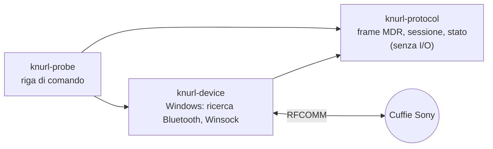

# knurl-probe

[English](README.md) · Italiano

Uno strumento a riga di comando per Windows che trova le cuffie Sony accoppiate al PC e registra come parlano con il protocollo di controllo di Sony (MDR). È il modo in cui [Knurl](https://github.com/DooperDrew/knurl), l'app del tray per le WH-1000XM3 e WH-1000XM4, impara un modello nuovo: chi ha le cuffie avvia il probe, e quello che registra diventa dati di test e supporto nell'app.

Qui c'è anche il codice che Knurl usa per parlare con le cuffie: il protocollo (`knurl-protocol`, senza I/O) e il collegamento di Windows (`knurl-device`).

## Stato
**Non c'è ancora nessuna release.** La prima (0.1.0) conterrà `knurl-probe.exe` in uno zip, così per avviarlo non servirà Rust.

**Usato su cuffie vere:** il 7 novembre 2026 il probe ha registrato il traffico della nostra WH-1000XM3 (firmware 4.5.2); quei frame sono i dati di test in `crates/knurl-protocol/tests/`. Risultati: [docs/04-risultati-xm3.md](docs/04-risultati-xm3.md).

**Non ancora verificato:**
- nessun altro modello, compresa la WH-1000XM4;
- il secondo servizio Sony (MDR v2), che secondo le fonti pubbliche usano i modelli più recenti: il probe lo apre, ma ancora niente lo decodifica.

## Cosa fa
Nessun comando cambia le impostazioni di Windows. `rfcomm-check` non manda dati e `watch` manda solo richieste di lettura. `capture` conferma (ACK) quello che mandano le cuffie, e manda altro solo se lo chiedi tu: i frame passati con `--send-on-connect` o scritti al suo prompt (`send <hex>`, `raw <hex>`).

| Comando | Cosa fa |
|---|---|
| `devices` | Elenca i dispositivi accoppiati con un servizio Sony MDR (`--all-services` elenca anche tutti i loro servizi RFCOMM) |
| `rfcomm-check --device <nome>` | Apre ogni servizio MDR e lo richiude; non manda dati |
| `capture --device <nome>` | Si collega e registra ogni byte nei due sensi in un file JSON-lines (`--guided` ti guida in una sessione di prova) |
| `watch` | Avvia lo stesso thread di collegamento dell'app Knurl e stampa cosa riporta (solo WH-1000XM3 e WH-1000XM4) |
| `audio` | Elenca i dispositivi audio di Windows, per distinguere quello stereo delle cuffie da quello per le chiamate (Hands-Free) |

**Privacy:** una cattura grezza contiene l'indirizzo Bluetooth delle cuffie. Finisce in `captures/raw/`, che git ignora; in questo repository entrano solo i frame, senza l'indirizzo.

## Avviarlo dal sorgente
Servono Windows 10 o 11, le cuffie accoppiate come Bluetooth classico (la voce senza `LE_`) e Rust (la versione esatta è in `rust-toolchain.toml`; rustup la installa).

```powershell
cargo run --release -p knurl-probe -- devices
cargo run --release -p knurl-probe -- capture --device WH-1000XM4 --guided
```

## Come è fatto


`knurl-protocol` non fa I/O, quindi i suoi test girano ovunque, anche su Linux, con byte catturati da cuffie vere. `knurl-device` apre il canale con Winsock (WinRT non lo vede). Le fonti del protocollo e per cosa è usata ciascuna: [docs/02-riferimenti-protocollo.md](docs/02-riferimenti-protocollo.md).

## Lavorarci
```powershell
cargo test --workspace
cargo clippy --workspace --all-targets -- -D warnings
cargo fmt --all --check
```
La CI fa i controlli Windows su un runner self-hosted sul PC del proprietario quando è impostata la variabile del repository `BEDROCK_RUNNER`, altrimenti sui runner di GitHub; Dependabot e le pull request dai fork girano sempre sui runner di GitHub, mai sul PC. Le modifiche arrivano su `main` con una pull request. Le regole per gli agenti sono in [CLAUDE.md](CLAUDE.md).

## Licenza
MIT o Apache-2.0, a scelta ([LICENSE-MIT](LICENSE-MIT), [LICENSE-APACHE](LICENSE-APACHE)). Lo zip della release contiene `THIRD-PARTY-NOTICES.txt`, generato da `scripts/third_party_notices.py`, con le licenze dei crate compilati nell'exe. Non affiliato a Sony; Sony e WH-1000XM sono marchi dei rispettivi proprietari.
