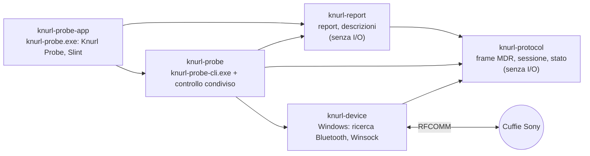

# knurl-probe

[English](README.md) · Italiano

Un'app per Windows, con una riga di comando per gli sviluppatori, che trova le cuffie Sony accoppiate al PC e registra come parlano con il protocollo di controllo di Sony (MDR). È il modo in cui Knurl, l'app del tray per le WH-1000XM3 e WH-1000XM4 (il suo repository non è ancora pubblico), impara un modello nuovo: chi ha le cuffie avvia il probe, e quello che registra diventa dati di test e supporto nell'app.

Qui c'è anche il codice che Knurl usa per parlare con le cuffie: il protocollo (`knurl-protocol`, senza I/O) e il collegamento di Windows (`knurl-device`).

## Stato
**Non c'è ancora nessuna release.** La prima (0.1.0) è pronta per il tag: uno zip, `knurl-probe-0.1.0-windows-x64.zip`, con `knurl-probe.exe` (l'app, Knurl Probe), `knurl-probe-cli.exe` (la riga di comando), i README, le licenze e le note sulle terze parti, più il suo SHA-256. Si estrae dove si vuole e si avvia `knurl-probe.exe`: niente installer, niente Rust. `scripts/package.py` costruisce lo zip e lo controlla (elenco esatto dei file, ogni exe byte per byte, le informazioni di versione dell'app, note aggiornate, checksum); la CI lo esegue a ogni pull request e la release usa lo stesso script. Sarà nella pagina delle release di questo repository dopo il push del tag `v0.1.0`.

**Usato su cuffie vere:** il 7 novembre 2026 il probe ha registrato il traffico della nostra WH-1000XM3 (firmware 4.5.2); quei frame sono i dati di test in `crates/knurl-protocol/tests/`. Risultati: [docs/04-risultati-xm3.md](docs/04-risultati-xm3.md).

**Non ancora verificato:**
- l'app su Windows: nessuno ha ancora guardato la sua finestra, e non ha controllato cuffie vere (il suo controllo è lo stesso codice di `knurl-probe-cli run`, che a sua volta non ha girato sulle cuffie dopo lo spostamento);
- trovare le cuffie che WinRT non elenca (come la WH-1000XM3) dal nome Sony e aprirle con Winsock, aggiunto il 22/11/2026: provato con elenchi d'esempio, non sulle cuffie. Le cuffie rinominate in Windows e non elencate da WinRT non vengono trovate;
- un invio vero dall'app (il relay accetta questi report solo dopo il suo prossimo deploy);
- nessun altro modello, compresa la WH-1000XM4;
- il secondo servizio Sony (MDR v2), che secondo le fonti pubbliche usano i modelli più recenti: il probe lo apre, ma ancora niente lo decodifica.

## Cosa fa
La riga di comando è `knurl-probe-cli.exe` (dal sorgente: `cargo run -p knurl-probe -- <comando>`). Nessun comando cambia le impostazioni di Windows. `rfcomm-check` non manda dati; `watch` e `run` mandano solo richieste di lettura. `capture` conferma (ACK) quello che mandano le cuffie, e manda altro solo se lo chiedi tu: i frame passati con `--send-on-connect` o scritti al suo prompt (`send <hex>`, `raw <hex>`).

| Comando | Cosa fa |
|---|---|
| `devices` | Elenca i dispositivi accoppiati con un servizio Sony MDR (`--all-services` elenca anche tutti i loro servizi RFCOMM) |
| `rfcomm-check --device <nome>` | Apre ogni servizio MDR e lo richiude; non manda dati |
| `run` | Controlla le cuffie in sola lettura (modello, firmware, protocollo, funzioni dichiarate, batteria e impostazioni su MDR v1; su MDR v2 solo la domanda sul protocollo) e scrive un report senza indirizzo Bluetooth né nomi personali, da allegare a una issue "New headphone model" (`--device` se ce n'è più di una) |
| `capture --device <nome>` | Si collega e registra ogni byte nei due sensi in un file JSON-lines (`--guided` ti guida in una sessione di prova) |
| `watch` | Avvia lo stesso thread di collegamento dell'app Knurl e stampa cosa riporta (solo WH-1000XM3 e WH-1000XM4) |
| `audio` | Elenca i dispositivi audio di Windows, per distinguere quello stereo delle cuffie da quello per le chiamate (Hands-Free) |

Questi funzionano su qualsiasi sistema e lavorano solo sui file:

| Comando | Cosa fa |
|---|---|
| `known` | Elenca le descrizioni dei modelli incluse nel probe (`headphones/`) e quanto è verificata ciascuna |
| `check REPORT [--against FILE]` | Confronta un report con una descrizione; codice di uscita 1 se differiscono |
| `draft REPORT --id ID --name NOME [--out FILE]` | Prepara la bozza della descrizione di un modello nuovo a partire da un report |
| `validate FILE...` | Controlla i file di descrizione; codice di uscita 1 se uno è sbagliato |

## Modelli
Ogni modello ha una descrizione in [`headphones/`](headphones): il servizio su cui risponde, la versione del protocollo, il firmware e i codici delle funzioni che dichiara, e quanto tutto questo è verificato (`unverified`, `reported` da un report, `verified` da due o più). Formati: [docs/format.md](docs/format.md) (in inglese). Per aggiungere un modello: [docs/contributing-headphones.md](docs/contributing-headphones.md) (in inglese).

| Modello | Stato | Su cosa si basa |
|---|---|---|
| WH-1000XM3 | reported | la cattura del 2026-11-07, riprodotta in un test che verifica che report e descrizione coincidano |
| WH-1000XM4 | unverified | solo fonti pubbliche |

**Privacy:** una cattura grezza contiene l'indirizzo Bluetooth delle cuffie. Finisce in `captures/raw/`, che git ignora; in questo repository entrano solo i frame, senza l'indirizzo.

## L'app
**Knurl Probe** (`knurl-probe.exe`, costruito da `crates/knurl-probe-app`) fa lo stesso controllo di `run`, per chi non è tecnico: cinque schermate con l'aspetto di Knurl, chiaro e scuro (design: [design/README.md](design/README.md), in inglese).

1. **Benvenuto:** cosa fa, cosa contiene il report e cosa non contiene mai (né l'indirizzo Bluetooth, né il nome del PC o dell'utente, né un nome dato alle cuffie).
2. **Scegli le cuffie:** le cuffie Sony accoppiate con Windows; se non ce ne sono, come accoppiarle e "Open Bluetooth settings".
3. **Controllo:** i passi, in sola lettura, su un thread separato.
4. **Risultato** in parole semplici: già supportate, modello nuovo, servizio più recente non ancora decodificato, oppure niente letto, con cosa è stato letto.
5. **Invio:** "Send" apre una issue in questo repository tramite il relay di bedrock, senza account GitHub; "See what will be sent" mostra prima la richiesta esatta. "Save to a file" (in Documenti\Knurl Probe) e il link al modulo "New headphone model" funzionano sempre. **Non verificato:** un invio vero (il relay accetta questi report solo dal suo prossimo deploy; fino ad allora l'app dice che il server non li accetta ancora) e l'app su Windows.

```powershell
cargo run --release -p knurl-probe-app
```

**Non ancora verificato:** l'app non ha mai girato su Windows né sulle cuffie; le schermate sono state controllate solo come immagini rese su Linux da `cargo run -p knurl-probe-app --example snapshot -- <cartella>`, con valori d'esempio. Il suo exe ha l'icona di Knurl e le sue informazioni di versione (controllate da `scripts/package.py`). Parla inglese, italiano e spagnolo (la lingua di Windows, oppure una scelta nella prima schermata); le traduzioni non sono state rilette da un madrelingua.

## Avviarlo dal sorgente
Servono Windows 10 o 11, le cuffie accoppiate come Bluetooth classico (la voce senza `LE_`) e Rust (la versione esatta è in `rust-toolchain.toml`; rustup la installa).

```powershell
cargo run --release -p knurl-probe -- devices
cargo run --release -p knurl-probe -- capture --device WH-1000XM4 --guided
```

## Come è fatto


`knurl-protocol` non fa I/O, quindi i suoi test girano ovunque, anche su Linux, con byte catturati da cuffie vere. `knurl-device` apre il canale con Winsock (WinRT non lo vede). Le fonti del protocollo e per cosa è usata ciascuna: [docs/02-riferimenti-protocollo.md](docs/02-riferimenti-protocollo.md).

## Documentazione
- [Indice della documentazione](docs/README.md): ogni documento con il riassunto e una mappa: visione, architettura, decisioni, formati, come aggiungere un modello, prove sull'hardware (i documenti nuovi sono in inglese).
- [Riferimento di design](design/README.md): l'aspetto dell'app.

## Lavorarci
```powershell
cargo test --workspace
cargo clippy --workspace --all-targets -- -D warnings
cargo fmt --all --check
```
La CI fa i controlli Windows su un runner self-hosted sul PC del proprietario quando è impostata la variabile del repository `BEDROCK_RUNNER`, altrimenti sui runner di GitHub; Dependabot e le pull request dai fork girano sempre sui runner di GitHub, mai sul PC. Le modifiche arrivano su `main` con una pull request. Le regole per gli agenti sono in [CLAUDE.md](CLAUDE.md).

## Licenza
MIT o Apache-2.0, a scelta ([LICENSE-MIT](LICENSE-MIT), [LICENSE-APACHE](LICENSE-APACHE)). Lo zip della release contiene `THIRD-PARTY-NOTICES.txt`, generato da `scripts/third_party_notices.py`, con le licenze dei crate compilati negli exe. L'app usa [Slint](https://slint.dev) con la licenza Slint Royalty-free 2.0, che chiede l'attribuzione: il badge "Made with Slint" nella prima schermata. Non affiliato a Sony; Sony e WH-1000XM sono marchi dei rispettivi proprietari.
