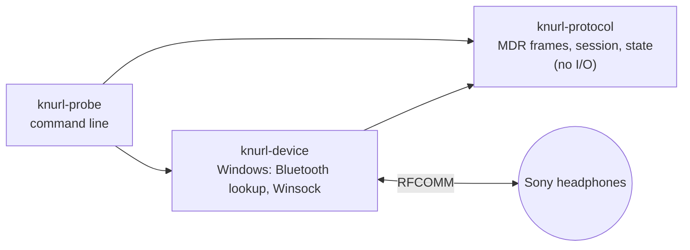

# knurl-probe

English · [Italiano](README.it.md)

A command-line tool for Windows that finds Sony headphones paired with the PC and records how they talk over Sony's control protocol (MDR). It is how [Knurl](https://github.com/DooperDrew/knurl), the tray app for the WH-1000XM3 and WH-1000XM4, learns a new model: someone with the headphones runs the probe, and what it records becomes test data and support in the app.

This repository also holds the code Knurl uses to talk to the headphones: the protocol (`knurl-protocol`, no I/O) and the Windows connection (`knurl-device`).

## Status
**Nothing is released yet.** The first release (0.1.0) will ship `knurl-probe.exe` in a zip, so you will not need Rust to run it.

**Used on real headphones:** on 7 November 2026 the probe recorded the traffic of our WH-1000XM3 (firmware 4.5.2); those frames are the test data in `crates/knurl-protocol/tests/`. Results: [docs/04-risultati-xm3.md](docs/04-risultati-xm3.md) (in Italian).

**Not verified yet:**
- any other model, the WH-1000XM4 included;
- the second Sony service (MDR v2), which public sources say newer models use: the probe can open it but nothing decodes it yet.

## What it does
No command changes Windows settings. `rfcomm-check` sends no data; `watch` and `report` send only read requests. `capture` acknowledges what the headphones send, and sends anything else only when you ask: frames passed with `--send-on-connect`, or typed at its prompt (`send <hex>`, `raw <hex>`).

| Command | What it does |
|---|---|
| `devices` | Lists paired devices that expose a Sony MDR service (`--all-services` also lists every RFCOMM service they report) |
| `rfcomm-check --device <name>` | Opens each MDR service and closes it again; sends no data |
| `report` | Checks the headphones read-only (model, firmware, protocol, the features they declare, battery and settings on MDR v1; on MDR v2 only the protocol question) and writes a report with no Bluetooth address and no personal names, to attach to a "New headphone model" issue (`--device` when several are paired) |
| `capture --device <name>` | Connects and records every byte in both directions to a JSON-lines file (`--guided` walks you through a test session) |
| `watch` | Runs the same connection thread as the Knurl app and prints what it reports (WH-1000XM3 and WH-1000XM4 only) |
| `audio` | Lists the Windows audio endpoints, to tell the headphones' stereo and call (Hands-Free) devices apart |

**Privacy:** a raw capture holds your headphones' Bluetooth address. It is written to `captures/raw/`, which git ignores; only the frames, without the address, ever go into this repository.

## Run it from source
You need Windows 10 or 11, the headphones paired as a classic Bluetooth device (the entry without `LE_`), and Rust (the exact version is pinned in `rust-toolchain.toml`; rustup installs it).

```powershell
cargo run --release -p knurl-probe -- devices
cargo run --release -p knurl-probe -- capture --device WH-1000XM4 --guided
```

## How it is built


`knurl-protocol` has no I/O, so its tests run anywhere, Linux included, from bytes captured on real headphones. `knurl-device` opens the channel with Winsock (WinRT does not see it). The protocol sources and what each one is used for: [docs/02-riferimenti-protocollo.md](docs/02-riferimenti-protocollo.md) (in Italian).

## Working on it
```powershell
cargo test --workspace
cargo clippy --workspace --all-targets -- -D warnings
cargo fmt --all --check
```
Changes reach `main` through pull requests. The rules for agents are in [CLAUDE.md](CLAUDE.md).

## License
MIT or Apache-2.0, at your option ([LICENSE-MIT](LICENSE-MIT), [LICENSE-APACHE](LICENSE-APACHE)). The release zip carries `THIRD-PARTY-NOTICES.txt`, generated by `scripts/third_party_notices.py`, with the licences of the crates compiled into the exe. Not affiliated with Sony; Sony and WH-1000XM are trademarks of their owners.
