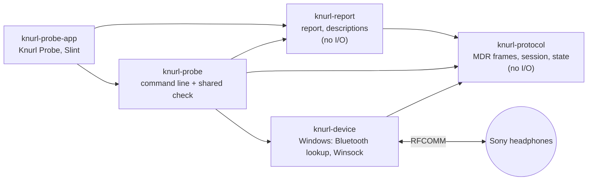

# knurl-probe

English · [Italiano](README.it.md)

A command-line tool for Windows that finds Sony headphones paired with the PC and records how they talk over Sony's control protocol (MDR). It is how [Knurl](https://github.com/DooperDrew/knurl), the tray app for the WH-1000XM3 and WH-1000XM4, learns a new model: someone with the headphones runs the probe, and what it records becomes test data and support in the app.

This repository also holds the code Knurl uses to talk to the headphones: the protocol (`knurl-protocol`, no I/O) and the Windows connection (`knurl-device`).

## Status
**Nothing is released yet.** The first release (0.1.0) will ship `knurl-probe.exe` in a zip, so you will not need Rust to run it.

**Used on real headphones:** on 7 November 2026 the probe recorded the traffic of our WH-1000XM3 (firmware 4.5.2); those frames are the test data in `crates/knurl-protocol/tests/`. Results: [docs/04-risultati-xm3.md](docs/04-risultati-xm3.md) (in Italian).

**Not verified yet:**
- any other model, the WH-1000XM4 included;
- the second Sony service (MDR v2), which public sources say newer models use: the probe can open it but nothing decodes it yet.

## What it does
No command changes Windows settings. `rfcomm-check` sends no data; `watch` and `run` send only read requests. `capture` acknowledges what the headphones send, and sends anything else only when you ask: frames passed with `--send-on-connect`, or typed at its prompt (`send <hex>`, `raw <hex>`).

| Command | What it does |
|---|---|
| `devices` | Lists paired devices that expose a Sony MDR service (`--all-services` also lists every RFCOMM service they report) |
| `rfcomm-check --device <name>` | Opens each MDR service and closes it again; sends no data |
| `run` | Checks the headphones read-only (model, firmware, protocol, the features they declare, battery and settings on MDR v1; on MDR v2 only the protocol question) and writes a report with no Bluetooth address and no personal names, to attach to a "New headphone model" issue (`--device` when several are paired) |
| `capture --device <name>` | Connects and records every byte in both directions to a JSON-lines file (`--guided` walks you through a test session) |
| `watch` | Runs the same connection thread as the Knurl app and prints what it reports (WH-1000XM3 and WH-1000XM4 only) |
| `audio` | Lists the Windows audio endpoints, to tell the headphones' stereo and call (Hands-Free) devices apart |

These run on any system and work on files only:

| Command | What it does |
|---|---|
| `known` | Lists the model descriptions that ship with the probe (`headphones/`) and how far each is checked |
| `check REPORT [--against FILE]` | Compares a report with a description; exit code 1 when they differ |
| `draft REPORT --id ID --name NAME [--out FILE]` | Drafts the description of a new model from a report |
| `validate FILE...` | Checks description files; exit code 1 when one is wrong |

## Models
Each model has a description in [`headphones/`](headphones): the service it answers on, its protocol version, firmware and the feature codes it declares, and how far that is checked (`unverified`, `reported` by one report, `verified` by two or more). Formats: [docs/format.md](docs/format.md). To add a model: [docs/contributing-headphones.md](docs/contributing-headphones.md).

| Model | Status | Backed by |
|---|---|---|
| WH-1000XM3 | reported | the capture of 2026-11-07, replayed in a test that checks report and description agree |
| WH-1000XM4 | unverified | public sources only |

**Privacy:** a raw capture holds your headphones' Bluetooth address. It is written to `captures/raw/`, which git ignores; only the frames, without the address, ever go into this repository.

## The app
**Knurl Probe** (`crates/knurl-probe-app`) is the same check as `run`, for people who are not technical: five screens in the Knurl look, light and dark (design: [design/README.md](design/README.md)).

1. **Welcome:** what it does, what the report holds and what it never holds (no Bluetooth address, no PC or user name, no name you gave your headphones).
2. **Choose your headphones:** the Sony headphones paired with Windows; if none, how to pair them and "Open Bluetooth settings".
3. **Checking:** the steps, read-only, on a background thread.
4. **Result** in plain words: already supported, new model, newer service not decoded yet, or nothing read, with what was read.
5. **Send:** "Send" opens an issue in this repository through the bedrock relay, without a GitHub account; "See what will be sent" shows the exact request first. "Save to a file" (into Documents\Knurl Probe) and the link to the "New headphone model" form always work. **Not verified:** a real send (the relay accepts these reports only after its next deploy; until then the app says the server does not accept them yet) and the app on Windows.

```powershell
cargo run --release -p knurl-probe-app
```

**Not verified yet:** the app has not run on Windows or on headphones; its screens were checked only as images rendered on Linux by `cargo run -p knurl-probe-app --example snapshot -- <folder>`, with sample values. It is not in a release yet. It speaks English, Italian and Spanish (Windows' language by default, a choice on the first screen); the translations were not read by a native speaker.

## Run it from source
You need Windows 10 or 11, the headphones paired as a classic Bluetooth device (the entry without `LE_`), and Rust (the exact version is pinned in `rust-toolchain.toml`; rustup installs it).

```powershell
cargo run --release -p knurl-probe -- devices
cargo run --release -p knurl-probe -- capture --device WH-1000XM4 --guided
```

## How it is built


`knurl-protocol` has no I/O, so its tests run anywhere, Linux included, from bytes captured on real headphones. `knurl-device` opens the channel with Winsock (WinRT does not see it). The protocol sources and what each one is used for: [docs/02-riferimenti-protocollo.md](docs/02-riferimenti-protocollo.md) (in Italian).

## Working on it
```powershell
cargo test --workspace
cargo clippy --workspace --all-targets -- -D warnings
cargo fmt --all --check
```
CI runs the Windows checks on a self-hosted runner on the owner's PC when the repository variable `BEDROCK_RUNNER` is set, else on GitHub-hosted runners; Dependabot and pull requests from forks always run on GitHub-hosted runners, never on the PC. Changes reach `main` through pull requests. The rules for agents are in [CLAUDE.md](CLAUDE.md).

## License
MIT or Apache-2.0, at your option ([LICENSE-MIT](LICENSE-MIT), [LICENSE-APACHE](LICENSE-APACHE)). The release zip carries `THIRD-PARTY-NOTICES.txt`, generated by `scripts/third_party_notices.py`, with the licences of the crates compiled into the exes. The app uses [Slint](https://slint.dev) under the Slint Royalty-free Licence 2.0, whose attribution is the "Made with Slint" badge on its first screen. Not affiliated with Sony; Sony and WH-1000XM are trademarks of their owners.
