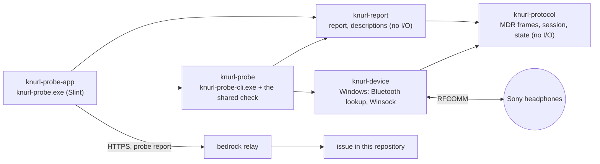

# Architecture

## Pure crates (any system)
- **`knurl-protocol`**: the MDR framing (start/end markers, escaping, checksum), messages, a sans-I/O `Session` and `Client` that turn received bytes into a device state and say which bytes to send. No I/O, no OS calls, no `unsafe`. Tested from bytes captured on real headphones (`tests/xm3_capture_2026_11_07.rs`, `tests/replay_xm3.rs`) and from public reference vectors.
- **`knurl-report`**: the report the probe writes and sends.
  - A sans-I/O `Collector` runs the read-only conversation. On MDR v1 it is the client's start-up sequence; on MDR v2, only the "which protocol" question, then 4 s of listening. It ends when every request is answered or failed, at the latest after 15 s.
  - The privacy rules live in one place: no address ever; the Windows device name kept only if it starts like a Sony model name (`WH-`, `WF-`, `WI-`, `MDR-`, `ULT `, `INZONE`, `LinkBuds`, `SRS-`), otherwise replaced by a placeholder.
  - Model descriptions (`headphones/*.toml`), the comparison of a report with a description, and the draft of a new one ([formats](format.md)).

## Windows crates
- **`knurl-device`**: finds paired devices and opens the MDR channel with Winsock `AF_BTH` (WinRT does not list the service: measured on the XM3, [docs/04](04-risultati-xm3.md)). It also runs the connection thread the Knurl app uses, and keeps the COM apartment alive for the whole process (the crash of 2026-11-08 in Knurl).
- **`knurl-probe`**: the command line (`knurl-probe-cli.exe`: `run`, `devices`, `rfcomm-check`, `capture`, `watch`, `audio`, and the file commands `known`, `check`, `draft`, `validate`, which run on any system) and a small library with the check itself (`check.rs`), shared by the command line and the app.
- **`knurl-probe-app`**: Knurl Probe (`knurl-probe.exe`).
  - The flow between the five screens (`flow.rs`) and what each screen shows (`view.rs`) have no I/O and are tested on any system.
  - The request to the relay (`send.rs`) is built and checked without I/O.
  - The Windows side (`windows_app.rs`, `winhttp.rs`) runs the lookup, the check and the send on background threads, never on the window's thread.
  - Texts in English, Italian and Spanish (`i18n.rs`, `lang/`).
  - The look follows the [design reference](../design/README.md).

## From the headphones to an issue
1. The app lists the paired Sony headphones; the person picks one.
2. The shared check opens MDR v1 (and v2 when Windows offers it), feeds every received frame to the `Collector`, writes back what it asks, and stops when it is done.
3. `knurl-report` builds the report (JSON): answers, verdict, every frame, problems, and the sanitized device name.
4. Save to a file writes it locally. Send wraps it in a `probe` report for the bedrock relay (the shared envelope, the report under `headphones`), shows the exact request first, and posts it with WinHTTP. The relay scrubs it again and opens an issue in this repository ([decision 0004](decisions/0004-send-through-the-relay.md), [decision 0007](decisions/0007-send-as-a-probe-report.md)).

## Release and CI
- `scripts/package.py` builds and checks the zip (both exes, READMEs, licences, notices, checksum); CI runs it on every pull request and `release.yml` uses it on a `v<version>` tag ([decision 0005](decisions/0005-ci-on-the-owners-runner.md)).

## Not verified
- The Windows parts (lookup, check, WinHTTP send, the app window) are compiled and linted in CI but not yet run against real headphones from the app: see [hardware tests](05-hardware-tests.md).
