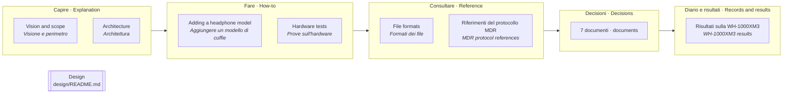

# Documentazione · Documentation

<!-- bedrock:docs-index:begin: generated by .github/bedrock/docs-index.mjs, do not edit by hand -->

## Mappa · Map

Ordine di lettura consigliato · Suggested reading order.

**Riferimento di design · Design reference:** [design/README.md](../design/README.md)

## Capire · Explanation

| Documento · Document | In breve · In short | Stato · Status | Verificato · Verified |
|---|---|---|---|
| [Vision and scope](01-vision.md) Visione e perimetro | What knurl-probe is for, who uses it, and what stays out. A cosa serve knurl-probe, chi lo usa e cosa resta fuori. | attuale · current | 2026-11-19 |
| [Architecture](03-architecture.md) Architettura | How the crates fit together, what is pure and what touches Windows, and how a report travels from the headphones to an issue. Come si incastrano i crate, cosa è puro e cosa tocca Windows, e come un report va dalle cuffie a una issue. | attuale · current | 2026-11-19 |

## Fare · How-to

| Documento · Document | In breve · In short | Stato · Status | Verificato · Verified |
|---|---|---|---|
| [Adding a headphone model](contributing-headphones.md) Aggiungere un modello di cuffie | How to check your Sony headphones with the probe and turn the report into a description of the model. Come controllare le tue cuffie Sony con il probe e trasformare il report nella descrizione del modello. | attuale · current | 2026-11-19 |
| [Hardware tests](05-hardware-tests.md) Prove sull'hardware | What was tested on real headphones, and the checklist still to run, step by step. Cosa è stato provato su cuffie vere e la lista di prove ancora da fare, passo per passo. | attuale · current | 2026-11-19 |

## Consultare · Reference

| Documento · Document | In breve · In short | Stato · Status | Verificato · Verified |
|---|---|---|---|
| [File formats](format.md) Formati dei file | The report (JSON) written by `run` and the model description (TOML) in headphones/. Il report (JSON) scritto da `run` e la descrizione del modello (TOML) in headphones/. | attuale · current | 2026-11-18 |
| [Riferimenti del protocollo MDR](02-riferimenti-protocollo.md) MDR protocol references | Cosa dicono le fonti pubbliche sul protocollo Sony MDR, con licenze, fonti e punti verificati sulle nostre cuffie. What public sources say about the Sony MDR protocol, with licenses, sources and what we verified on our headphones. | attuale · current | 2026-11-08 |

## Decisioni · Decisions

| Documento · Document | In breve · In short | Stato · Status | Verificato · Verified |
|---|---|---|---|
| [ADR-0001: A public repository that holds the probe and the protocol](decisions/0001-public-repo-with-the-protocol.md) ADR-0001: Un repository pubblico con il probe e il protocollo | knurl-probe is public, MIT OR Apache-2.0, and holds the protocol crates the private Knurl app uses. knurl-probe è pubblico, MIT OR Apache-2.0, e contiene i crate del protocollo usati dall'app Knurl, privata. | attuale · current | — |
| [ADR-0002: Reports in JSON, model descriptions in TOML, aligned with Keyfold Probe](decisions/0002-reports-and-descriptions.md) ADR-0002: Report in JSON, descrizioni dei modelli in TOML, come Keyfold Probe | A report is a JSON record written by the program; a description is a TOML file people edit, with a status that never claims more than the reports show. Il report è un JSON scritto dal programma; la descrizione è un TOML che le persone modificano, con uno stato che non dice mai più di quanto mostrano i report. | attuale · current | — |
| [ADR-0003: An app for people who are not technical, in the Knurl look](decisions/0003-an-app-for-non-technical-people.md) ADR-0003: Un'app per chi non è tecnico, con l'aspetto di Knurl | Knurl Probe is a Slint app with five screens in the Knurl family look; the command line stays for developers. Knurl Probe è un'app Slint con cinque schermate nell'aspetto della famiglia Knurl; la riga di comando resta per gli sviluppatori. | attuale · current | — |
| [ADR-0004: Send through the bedrock relay as a data report](decisions/0004-send-through-the-relay.md) ADR-0004: Invio tramite il relay di bedrock come report di tipo data | Send posts the report to the bedrock relay, which opens an issue here; no GitHub account, the exact request shown first. Invia manda il report al relay di bedrock, che apre una issue qui; nessun account GitHub, e la richiesta esatta è mostrata prima. | attuale · current | — |
| [ADR-0005: CI on the owner's runner, never for forks or Dependabot](decisions/0005-ci-on-the-owners-runner.md) ADR-0005: CI sul runner del proprietario, mai per i fork e Dependabot | While the repository is private and the account has no hosted minutes, the Windows checks run on a self-hosted runner; forks and Dependabot always go to GitHub-hosted runners. Finché il repository è privato e l'account non ha minuti, i controlli Windows girano su un runner self-hosted; fork e Dependabot vanno sempre sui runner di GitHub. | attuale · current | — |
| [ADR-0006: The project uses the bedrock kit](decisions/0006-the-bedrock-kit.md) ADR-0006: Il progetto usa il kit bedrock | Shared rules, checks and skills come from bedrock through sync PRs, as in every DooperDrew project. Regole, controlli e skill comuni arrivano da bedrock con PR di sync, come in ogni progetto DooperDrew. | attuale · current | — |
| [ADR-0007: Send as a probe report](decisions/0007-send-as-a-probe-report.md) ADR-0007: Invio come report di tipo probe | Send posts the report as the relay's probe kind, a JSON object behind the envelope the probes share, instead of a data attachment. Invia manda il report come tipo probe del relay, un oggetto JSON dietro l'intestazione comune alle sonde, invece che come allegato data. | attuale · current | — |

## Diario e risultati · Records and results

| Documento · Document | In breve · In short | Stato · Status | Verificato · Verified |
|---|---|---|---|
| [Risultati sulla WH-1000XM3](04-risultati-xm3.md) WH-1000XM3 results | Cosa abbiamo verificato sulla XM3 dell'utente e cosa resta aperto. What we verified on the user's XM3 and what is still open. | attuale · current | 2026-11-08 |

<!-- bedrock:docs-index:end -->
