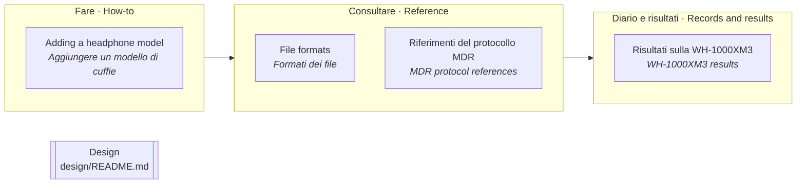

# Documentazione · Documentation

<!-- bedrock:docs-index:begin: generated by .github/bedrock/docs-index.mjs, do not edit by hand -->

## Mappa · Map

Ordine di lettura consigliato · Suggested reading order.

**Riferimento di design · Design reference:** [design/README.md](../design/README.md)

## Fare · How-to

| Documento · Document | In breve · In short | Stato · Status | Verificato · Verified |
|---|---|---|---|
| [Adding a headphone model](contributing-headphones.md) Aggiungere un modello di cuffie | How to check your Sony headphones with the probe and turn the report into a description of the model. Come controllare le tue cuffie Sony con il probe e trasformare il report nella descrizione del modello. | attuale · current | 2026-11-18 |

## Consultare · Reference

| Documento · Document | In breve · In short | Stato · Status | Verificato · Verified |
|---|---|---|---|
| [File formats](format.md) Formati dei file | The report (JSON) written by `run` and the model description (TOML) in headphones/. Il report (JSON) scritto da `run` e la descrizione del modello (TOML) in headphones/. | attuale · current | 2026-11-18 |
| [Riferimenti del protocollo MDR](02-riferimenti-protocollo.md) MDR protocol references | Cosa dicono le fonti pubbliche sul protocollo Sony MDR, con licenze, fonti e punti verificati sulle nostre cuffie. What public sources say about the Sony MDR protocol, with licenses, sources and what we verified on our headphones. | attuale · current | 2026-11-08 |

## Diario e risultati · Records and results

| Documento · Document | In breve · In short | Stato · Status | Verificato · Verified |
|---|---|---|---|
| [Risultati sulla WH-1000XM3](04-risultati-xm3.md) WH-1000XM3 results | Cosa abbiamo verificato sulla XM3 dell'utente e cosa resta aperto. What we verified on the user's XM3 and what is still open. | attuale · current | 2026-11-08 |

## Da scrivere · To write

- Visione e perimetro · Vision and scope (`topic: vision`, modulo · module `core`)
- Architettura · Architecture (`topic: architecture`, modulo · module `core`)
- Decisioni · Decisions (`topic: decisions`, modulo · module `core`)
- Prove sull'hardware · Hardware tests (`topic: hardware-tests`, modulo · module `hardware`)

<!-- bedrock:docs-index:end -->
